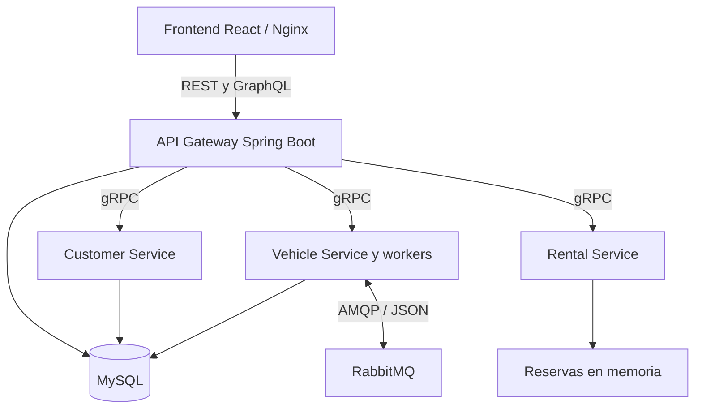

# Rentar — Sistema distribuido de alquiler de vehículos

Trabajo práctico grupal de **Desarrollo de Software en Sistemas Distribuidos**, Universidad Nacional de Lanús (UNLa). **Grupo L — 2026**.

Rentar permite administrar clientes y vehículos, consultar disponibilidad, crear y cancelar reservas y consultar el historial de alquileres. Combina una interfaz web, APIs REST y GraphQL, servicios gRPC y procesamiento asíncrono mediante RabbitMQ.


## Contenido

- [Arquitectura](#arquitectura)
- [Servicios y responsabilidades](#servicios-y-responsabilidades)
- [Comunicación asíncrona](#comunicación-asíncrona)
- [Configuración y ejecución](#configuración-y-ejecución)
- [Accesos y usuarios de prueba](#accesos-y-usuarios-de-prueba)
- [Contratos y estructura](#contratos-y-estructura)
- [Verificación y diagnóstico](#verificación-y-diagnóstico)
- [Limitaciones y consistencia documental](#limitaciones-y-consistencia-documental)
- [Integrantes y tareas](#integrantes-y-tareas)

## Arquitectura



El navegador accede al frontend publicado en el puerto 5173. En Docker, Nginx sirve los archivos estáticos y reenvía `/api/` y `/graphql` al API Gateway.

El Gateway autentica usuarios mediante JWT, aplica controles de acceso y traduce las operaciones REST/GraphQL a llamadas gRPC a los servicios internos. También accede a MySQL para autenticación e inicialización de datos. Por lo tanto, en esta implementación no actúa únicamente como proxy.

Customer Service y Vehicle Service acceden a la misma base MySQL configurada en Compose. Rental Service mantiene las reservas en memoria. No se implementa una base independiente por microservicio.

Los validadores externos, el coordinador, la incorporación, la verificación policial y el mantenimiento son **workers iniciados dentro del proceso de Vehicle Service**, con consumidores diferenciados. No son contenedores independientes.

## Servicios y responsabilidades

| Servicio en Compose | Directorio | Tecnología | Responsabilidades |
|---|---|---|---|
| `frontend` | `frontend/` | React, TypeScript, Vite; Nginx en Docker | Interfaz, inicio de sesión, gestión y consultas mediante REST/GraphQL. |
| `api-gateway` | `api-gateway/` | Java 17, Spring Boot, Spring Security, JPA, GraphQL y clientes gRPC | Entrada HTTP, JWT, autorización, validaciones y coordinación de operaciones. |
| `customer-service` | `customer-service/` | Node.js, TypeScript, gRPC y mysql2 | ABM y consulta de clientes; verificación de existencia y estado activo. |
| `vehicle-service` | `vehicle-service/` | Node.js, TypeScript, gRPC, mysql2 y amqplib | Gestión de flota, estados, filtrado de disponibilidad, solicitudes externas y workers RabbitMQ. |
| `rental-service` | `rentar-service/` | Node.js, TypeScript y gRPC | Creación, consulta y cancelación de reservas; historial y detección de superposición de períodos. |
| `mysql` | Definido en `compose.yaml` | MySQL 8.4 | Persistencia compartida de datos relacionales. |
| `rabbitmq` | Definido en `compose.yaml` | RabbitMQ 3 con Management | Enrutamiento de mensajes entre productores y consumidores. |

### Reserva y disponibilidad

Para crear una reserva, el Gateway verifica al cliente mediante Customer Service, consulta el vehículo mediante Vehicle Service, calcula el importe y solicita el alta a Rental Service. Luego actualiza el vehículo a `RESERVADO`. Si falla esa actualización, intenta compensar cancelando la reserva creada.

Rental Service rechaza reservas confirmadas que se superponen para el mismo vehículo. Los períodos contiguos no se consideran superpuestos. La consulta de disponibilidad combina las reservas ocupadas del período con los filtros del catálogo de vehículos.

Los estados operativos del vehículo son `DISPONIBLE`, `RESERVADO` y `EN_ALQUILER`. El atributo `activo` representa su habilitación. `ROBADO` es un resultado de verificación, no un estado operativo adicional.

## Comunicación asíncrona

Los mensajes se serializan como JSON. La topología implementada combina un exchange `topic` para vehículos externos y exchanges `direct` para verificación policial y mantenimiento.

### Topología implementada

| Flujo | Exchange | Tipo | Routing key | Cola |
|---|---|---|---|---|
| Solicitud policial | `verificacion_policial_exchange` | direct | `vehiculo.solicitado` | `cola_verificacion_policial_solicitudes` |
| Resultado policial | `verificacion_resultado_exchange` | direct | `vehiculo.resultado` | `cola_verificacion_policial_resultados` |
| Registro externo: patente | `rentar.topic.exchange` | topic | `vehiculos.externos.registrados` | `q.externos.validador-patente` |
| Registro externo: titularidad | `rentar.topic.exchange` | topic | `vehiculos.externos.registrados` | `q.externos.validador-titularidad` |
| Resultado de patente | `rentar.topic.exchange` | topic | `vehiculos.externos.validacion.patente` | `q.rentar.externos-val-patente` |
| Resultado de titularidad | `rentar.topic.exchange` | topic | `vehiculos.externos.validacion.titularidad` | `q.rentar.externos-val-titularidad` |
| Incorporación aprobada | `rentar.topic.exchange` | topic | `vehiculos.externos.validacion.completada` | `q.rentar.externos-completada` |
| Solicitud de mantenimiento | `mantenimiento_preventivo_exchange` | direct | `reserva.confirmada` | `cola_mantenimiento_preventivo_solicitudes` |
| Resultado de mantenimiento | `mantenimiento_resultado_exchange` | direct | `mantenimiento.resultado` | `cola_mantenimiento_preventivo_resultados` |

Las routing keys policiales anteriores son las usadas por el código actual. Difieren de los nombres `vehiculos.verificacion.solicitada` y `vehiculos.verificacion.resultado` presentados en el enunciado y en el documento de topología inicial.

### Verificación policial de vehículos

1. Vehicle Service registra el vehículo y dispara la publicación sin esperar el resultado policial.
2. El worker policial consume la solicitud y genera `VALIDADO` o `ROBADO`.
3. El consumidor de resultados inhabilita los vehículos con resultado `ROBADO` mediante baja lógica (`activo = false`).

En esta revisión, el worker policial general simula el resultado mediante `Math.random()` —20 % de probabilidad de robo—. No consulta un registro fijo de patentes. El resultado validado se informa por logs; el consumidor no persiste un campo específico de verificación.

### Incorporación de vehículos externos

El cliente autenticado solicita la incorporación mediante `POST /api/vehiculos-externos`. El Gateway responde `202 Accepted`; la aceptación de la solicitud no equivale a la incorporación definitiva.

La solicitud comienza en `PENDIENTE`. El evento de registro se distribuye a dos colas independientes: una verifica la patente y otra la titularidad. Los resultados se correlacionan mediante `vehiculoExternoId`. Si una validación falla, la solicitud se rechaza. Si ambas son satisfactorias, el coordinador habilita la incorporación y el vehículo se agrega a la flota como `DISPONIBLE`.

Los estados de la solicitud son `PENDIENTE`, `APROBADA`, `RECHAZADA` e `INCORPORADA`; son distintos de los estados operativos del vehículo.

Se utiliza la tabla `externos_outbox` para guardar eventos pendientes. El publicador usa confirmaciones del broker y vuelve a intentar la publicación de pendientes. Las claves únicas evitan duplicar determinadas respuestas. Esto no implica una garantía general de procesamiento exactamente una vez.

Ejemplo del evento de registro —los identificadores se representan como cadenas en estos contratos TypeScript—:

```json
{
  "vehiculoExternoId": "50",
  "clienteId": "89",
  "patente": "AH321JK",
  "documento": "35123456"
}
```

Los contratos completos se encuentran en [`vehicle-service/src/externos/types.ts`](vehicle-service/src/externos/types.ts).

Para consultar el progreso se utilizan `GET /api/vehiculos-externos` y `GET /api/vehiculos-externos/{id}`. Estas operaciones están restringidas al rol `CLIENTE` y a las solicitudes del usuario correspondiente.

Datos del registro simulado para preparar pruebas con el cliente inicial, documento `35123456`:

| Patente | Patente policial | Titularidad | Resultado esperado de la solicitud |
|---|---|---|---|
| `AH321JK` | VALIDADO | VALIDADO | Incorporación |
| `AF999ZZ` | RECHAZADO | VALIDADO | Rechazo por denuncia |
| `AB123CD` | VALIDADO | RECHAZADO | Rechazo por titularidad: pertenece al documento `30111222` |

Usar estos casos cuando no exista previamente una solicitud para la misma patente. Los registros simulados se encuentran en `externos/patenteWorker.ts` y `externos/registroTitularidad.ts`.

### Mantenimiento preventivo

Existen un publicador de `reserva.confirmada`, un worker de mantenimiento y un consumidor de resultados en `vehicle-service/src/`. El worker simula `REALIZADO` con probabilidad del 80 % y `NO_REALIZADO` en los demás casos.

**Estado de integración de esta revisión:** el flujo de creación de reservas revisado en el Gateway y Rental Service no invoca al publicador. El consumidor de mantenimiento escribe el resultado por consola, pero no lo persiste asociado a una reserva. Por ello, este flujo todavía no debe presentarse como una funcionalidad completa de extremo a extremo.

## Configuración y ejecución

### Requisitos

- Git.
- Docker con soporte para contenedores Linux; en Windows, Docker Desktop iniciado.
- Docker Compose v2 con soporte para `--wait`.
- Conexión a Internet para descargar imágenes y dependencias en la primera construcción.
- Puertos locales libres: `3306`, `5672`, `15672`, `50051`, `50052`, `50053`, `8080` y `5173`.

La ejecución mediante Docker no requiere instalar Java, Maven, Node.js o MySQL en el equipo. Los Dockerfiles utilizan Java 17 y Node.js 24 para el backend.

### 1. Clonar la versión documentada

```bash
git clone --branch develop https://github.com/facudaddese/TP-SistDistribuidos-GrupoL.git
cd TP-SistDistribuidos-GrupoL
```

### 2. Configurar variables —opcional—

`compose.yaml` contiene valores de demostración por defecto. Para personalizarlos, copiar `.env.example` a `.env` en la raíz.

PowerShell:

```powershell
Copy-Item .env.example .env
```

Bash:

```bash
cp .env.example .env
```

| Variable | Valor predeterminado | Uso |
|---|---|---|
| `MYSQL_DATABASE` | `rentar_db` | Base de datos |
| `MYSQL_USER` | `rentar_user` | Usuario de aplicación |
| `MYSQL_PASSWORD` | `rentar_password` | Contraseña de aplicación |
| `MYSQL_ROOT_PASSWORD` | `rentar_root_password` | Contraseña inicial de root |
| `RABBITMQ_USER` | `rentar_rabbit` | Usuario del broker |
| `RABBITMQ_PASSWORD` | `rentar_rabbit_pass` | Contraseña del broker |

Aunque `.env.example` incluye `MYSQL_PORT`, `RABBITMQ_PORT` y `RABBITMQ_MGMT_PORT`, los puertos publicados están fijados en `compose.yaml`. Cambiar esas variables en `.env` no modifica los mapeos actuales. Para cambiar un puerto de acceso local, editar el lado izquierdo del mapeo `host:contenedor` en Compose.

Dentro de Docker se utilizan los nombres de servicio, como `mysql`, `rabbitmq` y `rental-service`. `localhost` dentro de un contenedor apunta a ese mismo contenedor.

### 3. Construir e iniciar

Desde la raíz del proyecto:

```bash
docker compose config --quiet
docker compose up -d --build --wait
docker compose ps -a
```

Compose coordina el inicio mediante dependencias y healthchecks. El Gateway configura el esquema JPA con `ddl-auto=update` e inicializa usuarios y vehículos de demostración. Vehicle Service prepara las tablas del flujo de externos.

La comprobación de salud no reemplaza las pruebas funcionales: un puerto gRPC disponible no demuestra que todos los consumidores RabbitMQ estén operativos.

### 4. Detener y volver a iniciar

```bash
docker compose down
docker compose up -d --wait
```

`down` conserva los volúmenes `mysql_data` y `rabbitmq_data`. Las reservas gRPC de Rental Service se pierden al reiniciar su proceso porque se almacenan en memoria.

Las credenciales de inicialización de MySQL y RabbitMQ se aplican al crear sus datos. Cambiar `.env` después de inicializar volúmenes no actualiza automáticamente los usuarios existentes.

## Accesos y usuarios de prueba

Los puertos publicados están vinculados a `127.0.0.1` en Compose.

| Recurso | Dirección |
|---|---|
| Frontend | http://localhost:5173 |
| API Gateway | http://localhost:8080 |
| Swagger UI | http://localhost:8080/swagger-ui/index.html |
| GraphQL —solicitudes POST— | http://localhost:8080/graphql |
| Salud del Gateway | http://localhost:8080/actuator/health |
| RabbitMQ Management | http://localhost:15672 |
| RabbitMQ AMQP | localhost:5672 |
| Customer Service gRPC | localhost:50051 |
| Vehicle Service gRPC | localhost:50052 |
| Rental Service gRPC | localhost:50053 |
| MySQL | localhost:3306 |

GraphiQL está deshabilitado en `application.properties`. Para GraphQL se puede utilizar Postman enviando un cuerpo JSON con `query` y, cuando corresponda, `variables`.

| Cuenta | Usuario | Contraseña inicial |
|---|---|---|
| Administrador | `admin@rentar.com` | `admin123` |
| Cliente activo | `cliente@rentar.com` | `cliente123` |
| Cliente inactivo | `inactivo@rentar.com` | `inactivo123` |
| RabbitMQ | `rentar_rabbit` | `rentar_rabbit_pass` |

Los usuarios de aplicación se crean cuando no existe su email. La cuenta inactiva permite probar el rechazo de acceso. RabbitMQ utiliza las credenciales de `.env` si se personalizan.

Para las operaciones protegidas de la API, obtener el JWT mediante el inicio de sesión y enviarlo en `Authorization: Bearer <token>`. Las cuentas y claves anteriores corresponden al entorno académico de demostración.

## Contratos y estructura

| Ruta | Contenido |
|---|---|
| `api-gateway/` | API HTTP, seguridad, clientes gRPC y entidades JPA |
| `api-gateway/src/main/proto/` | Contratos Protobuf utilizados para generar los clientes Java |
| `api-gateway/src/main/resources/graphql/schema.graphqls` | Esquema GraphQL |
| `customer-service/proto/customer.proto` | Contrato de clientes |
| `vehicle-service/proto/vehicle.proto` | Contrato de vehículos y solicitudes externas |
| `rentar-service/proto/rental.proto` | Contrato de reservas |
| `vehicle-service/src/externos/` | Validadores, coordinación, incorporación, repositorio y outbox |
| `frontend/` | Aplicación web y configuración Nginx |
| `compose.yaml` | Servicios, red, variables, puertos, volúmenes y healthchecks |
| `.env.example` | Variables de ejemplo |
| `Dockerfile.node` | Construcción común de los servicios Node.js |

Las consultas GraphQL incluyen `obtenerTodosLosVehiculos`, `consultarDisponibilidad`, `consultarReservas` e `historialAlquileres`. Para los campos, filtros y tipos exactos, consultar el esquema versionado.

Los archivos `.proto` están presentes en los servicios y en el Gateway. Al modificar un contrato, mantener sincronizadas las copias correspondientes y reconstruir las imágenes afectadas.

## Verificación y diagnóstico

### Comandos de diagnóstico

```bash
docker compose ps -a
docker compose logs --tail=100 api-gateway
docker compose logs --tail=100 customer-service rental-service
docker compose logs -f vehicle-service rabbitmq
```

Para reconstruir un servicio luego de modificarlo:

```bash
docker compose up -d --build vehicle-service
```

| Síntoma | Revisión sugerida |
|---|---|
| Puerto ocupado | Revisar los puertos publicados en `compose.yaml` y los procesos locales. |
| Gateway no inicia | Consultar sus logs y el estado de MySQL y los servicios gRPC. |
| Error gRPC `UNAVAILABLE` | Revisar servicio destino, puerto y dirección configurada. |
| HTTP 401/403 | Revisar token, estado del usuario y rol requerido. |
| Solicitud externa permanece pendiente | Revisar logs de workers, consumidores de las colas y pendientes de outbox. |
| Credenciales del broker rechazadas | Verificar `.env` y las credenciales con las que se inicializó el volumen. |
| Reservas desaparecen tras reiniciar | Comportamiento actual de Rental Service: almacenamiento en memoria. |

### Casos para la documentación de entrega

- Inicio de sesión y validaciones de acceso.
- ABM de clientes y vehículos.
- Disponibilidad por fechas, creación de reserva, rechazo de superposición y cancelación.
- Consultas de reservas e historial mediante GraphQL y llamadas gRPC desde Postman.
- Registro de vehículo y seguimiento de solicitud/resultado policial en logs; baja lógica si resulta robado.
- Incorporación externa exitosa y rechazos por patente y titularidad.
- Mantenimiento: prueba de extremo a extremo después de completar la integración pendiente.

Para cada caso, registrar datos de entrada, resultado esperado, resultado obtenido y capturas. Un video puede acompañar estas evidencias. Esta lista propone pruebas; no afirma que hayan sido ejecutadas.

## Limitaciones y consistencia documental

La revisión documentada presenta estos puntos que deben resolverse o declararse antes de la entrega:

1. **Persistencia de reservas:** Rental Service utiliza memoria y pierde sus datos al reiniciarse.
2. **Mantenimiento incompleto:** falta conectar la publicación con el alta real de reservas y persistir el resultado asociado.
3. **Simulación policial general:** usa un resultado aleatorio; el enunciado solicita consultar un registro propio simulado. El flujo de externos sí consulta registros fijos.
4. **Topología documental:** `rentar.topic.exchange.md` presenta una topología inicial con colas sugeridas que no representa completamente los exchanges directos actuales. Debe actualizarse junto con el código si se unifican los nombres.
5. **Guía Docker anterior:** `README.Docker.md` contiene una advertencia sobre la pantalla de confirmación de reserva. Debe contrastarse con la versión del frontend de entrega y actualizarse según el resultado de la prueba.

Al cambiar un servicio, revisar conjuntamente sus contratos, configuración Compose, variables de entorno, rutas, eventos y documentación. La entrega debe identificar la misma revisión del código que se utilizó para realizar las pruebas y capturas.

## Integrantes y tareas

### Participación por hito

El proyecto contó con cinco integrantes en el hito 1, cuatro en el hito 2 y tres en el hito 3. Se conservan los aportes de quienes participaron en las etapas anteriores.

| Integrante | GitHub | Hito 1 | Hito 2 | Hito 3 |
|---|---|:---:|:---:|:---:|
| Facundo D’Addese | [facudaddese](https://github.com/facudaddese) | Sí | Sí | Sí |
| Dante Gissara | [dantegissara](https://github.com/dantegissara) | Sí | Sí | Sí |
| Marco Carreira | [carreiraMarco](https://github.com/carreiraMarco) | Sí | Sí | Sí |
| Alejo Brites | [AlejoBrites](https://github.com/AlejoBrites) | Sí | Sí | — |
| Lucas Cardozo | [LucaasCardozo](https://github.com/LucaasCardozo) | Sí | — | — |

Lucas Cardozo participó hasta el hito 1 inclusive y Alejo Brites hasta el hito 2 inclusive. El hito 3 fue desarrollado por Facundo D’Addese, Dante Gissara y Marco Carreira.

### Aportes de los hitos anteriores

| Integrante | Tareas registradas en etapas anteriores |
|---|---|
| Facundo D’Addese | Consultas GraphQL de disponibilidad, reservas, historial y vehículos; Rental Service gRPC; Swagger y API Gateway. |
| Marco Carreira | Gestión REST de vehículos y clientes; alta y cancelación de reservas REST. |
| Alejo Brites | ABM de vehículos, alta y cancelación de reservas en backend; implementación y diseño de login. |
| Dante Gissara | ABM de clientes; backend de disponibilidad, reservas e historial GraphQL; Dockerización de MySQL; Vehicle Service gRPC. |
| Lucas Cardozo | Modificación y consulta de flota en backend; historial por cliente en frontend. |

### Tareas del hito 3

#### Facundo D’Addese

- Verificación asíncrona de vehículos.
- Mantenimiento preventivo asociado a una reserva.

#### Dante Gissara

- Incorporación asíncrona de vehículos de propietarios externos.
- Dockerización e integración del proyecto completo mediante Docker Compose.

#### Marco Carreira

- Configuración de la infraestructura de RabbitMQ y diseño de la topología de eventos.
- Corrección del API Gateway REST/GraphQL *(corrección del hito 2)*.
- Documentación de los endpoints REST mediante Swagger *(corrección del hito 2)*.
